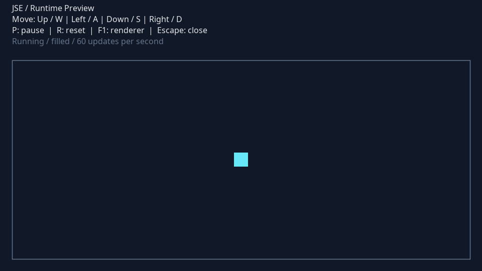
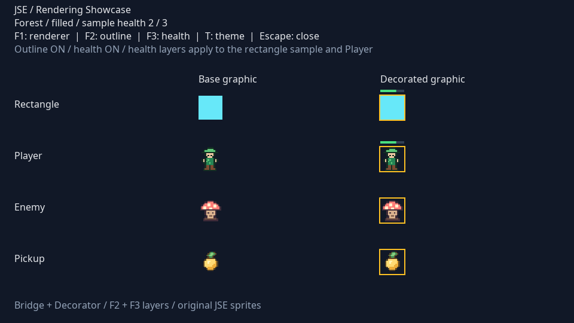
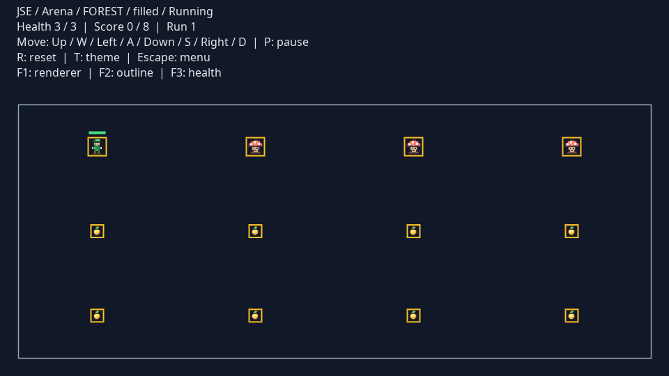

# Java Simple Engine

JSE is a compact Java 17 runtime for 2D desktop applications. It provides fixed updates, scene lifecycle, keyboard actions and interchangeable Java2D rendering. It includes a configurable preview, an independent rendering showcase and an Arena integrating six design patterns with real game entities.



## Build and run

Install **JDK 17 or newer**. The Maven Wrapper selects Maven 3.9.9; the first build downloads build dependencies. Production code uses the JDK only.

```sh
./mvnw clean verify
java -jar target/jse-demo.jar --example game
```

On Windows, replace `./mvnw` with `mvnw.cmd`. The packaged application runs without Maven, an IDE or a network connection. A desktop display is required for the window. Tests and help work without a display:

```sh
java -Djava.awt.headless=true -jar target/jse-demo.jar --help
```

The preview supports movement with WASD or arrows, **P** to pause/resume, **R** to reset, **F1** to switch Filled/Wireframe rendering and **Escape** to close. Losing window focus clears input and pauses movement; press P after returning. Reset centers the object and resumes movement.

Run the rendering showcase to compare plain and decorated graphics:

```sh
java -jar target/jse-demo.jar --example showcase
```

Use **F1** for Filled/Wireframe, **F2** for outline, **F3** for health bars, **T** for Forest/Space sprites and **Escape** to close. The sample health is 2/3; only Player and the rectangle health sample receive a health layer. Both examples support `--config FILE`; `--example preview` explicitly selects the default preview. Binding conflicts are checked only among the selected example's active actions, so existing Preview overrides can still use T/F2/F3.



## Game integration

```sh
java -jar target/jse-demo.jar --example game
```

The menu offers **Enter** for Arena and **H** for Showcase. **Escape** returns to the menu and closes from the menu. In Arena, use WASD/arrows to move, **P** to pause, **R** for a fresh run, **T** for the other theme, and **F1/F2/F3** for renderer/outline/health layers. Losing focus pauses until P is pressed. Visual choices survive reset, theme changes and menu/Showcase transitions.

Collect eight pickups and avoid enemy contact. The health bar reads the real Player; contact deals one damage with a 0.75-second cooldown. Win/loss freezes movement while keeping visual and navigation controls. Enemies start with Patrol, Chase and Flee. **Tab** selects an enemy, **B** cycles its strategy, and **L** detaches/recreates the event log while HUD updates continue. AI selection and log controls remain available during pause or after an outcome.



## Configuration

Runtime defaults live in [jse.properties](src/main/resources/jse.properties); showcase visuals and shared sprite paths live in [showcase.properties](src/main/resources/showcase.properties); game values live in [game.properties](src/main/resources/game.properties). Supply a UTF-8 file containing only the values to override:

```properties
window.width=1024
window.height=640
preview.speed=300
render.mode=WIREFRAME
input.move_up=I,UP
```

```sh
java -jar target/jse-demo.jar --config preview.properties
```

Showcase overrides include `showcase.outline_width`, `showcase.bar_offset`, `showcase.bar_height`, `showcase.health_current`, `showcase.health_max` and each `showcase.forest_*` / `showcase.space_*` sprite path. Showcase and game layouts are checked before startup, including borders, health bars, configured help text and menu font metrics. Larger samples or fonts may need a larger window.

Unknown keys, conflicting bindings, invalid colors and layouts that cannot fit the object are rejected before startup. Resource paths are relative to the classpath; configured sprites are preloaded before the update timer starts.

## Project status

The runtime foundation, Bridge and Decorator are implemented, with two working renderer styles, two standalone examples and a game menu/integration. Six original transparent sprites are packaged; their editable source and attribution are included.

All six design patterns are integrated into the real Arena: both family factories, three spawners, graphics/decorators, AI strategies and independent HUD/log observers. The EventBus uses synchronous delivery with deferred nested publications; a bounded next-tick protocol is future work. See [development status](docs/Development-Status.md) for completed work and the next handoff.

## Team

| Contributor | Responsibility | Design patterns |
| --- | --- | --- |
| Sabirzhanov Emil | Runtime, desktop host, input, rendering, assets, rendering showcase | Bridge; Decorator |
| Baktiyarova Aruzhan | Game object model, spawners, Forest/Space families, arena layout | Factory Method; Abstract Factory |
| Roziyeva Yasmina | World, AI, collisions, events, rules, game scenes and observers | Strategy; Observer |

Bridge, Decorator, Factory Method, Abstract Factory, Strategy and Observer are implemented and observable in the unified application. The pattern diagrams describe the actual class roles and current synchronous event flow.

## Documentation

- [Technical specification](docs/JSE-Technical-Specification.md): scope, contracts, game behavior and acceptance criteria.
- [Implementation plan](docs/Implementation-Plan.md): completed foundation steps and team milestones.
- [Integration guide](docs/Integration-Guide.md): concrete boundaries for parallel development.
- [Runtime design](docs/design/Runtime-Foundation.md): lifecycle and timing decisions.
- [Verification](docs/Verification.md): commands, results and practical limits.
- [Contributing](CONTRIBUTING.md) and [GitHub setup](docs/GitHub-Setup.md).

[Runtime architecture](docs/uml/rendered/runtime-architecture.svg), runtime lifecycle and [rendering patterns](docs/uml/rendered/rendering-patterns.svg) and factory patterns describe implemented code. The architecture, behavior and sequence diagrams describe the consolidated implementation.

## Report and delivery

The team report draft is available as [PDF](docs/report/JSE-Technical-Report.pdf) and [editable DOCX](docs/report/JSE-Technical-Report.docx). It includes the six patterns, actual source excerpts, UML, screenshots, verification results and limitations. [Emil defense notes](docs/report/Emil-Defense-Notes.txt) summarize the two rendering patterns. Review course-specific cover details before submission.

Regenerate the report after a passing build:

```sh
python3 -m venv /tmp/jse-report-env
/tmp/jse-report-env/bin/pip install -r tools/requirements-report.txt
/tmp/jse-report-env/bin/python tools/build_report.py
libreoffice --headless --convert-to pdf --outdir docs/report docs/report/JSE-Technical-Report.docx
```

`report-content.json` is the editable prose source. Code excerpts are extracted from Java, test totals come from Surefire XML, and screenshots come from the real application. `tools/DesktopVerification.java` provides display-enabled integration checks and captures current figures; it needs a desktop display. The independent runtime preview remains the default when `--example` is omitted.
