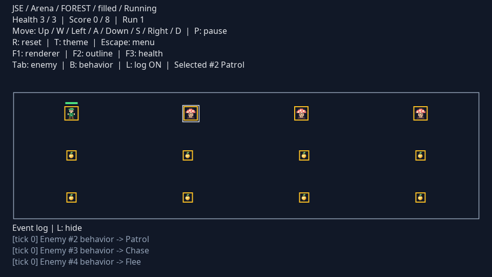

# Java Simple Engine

JSE is a Java 17 desktop application with a small collection arena and an independent rendering showcase. It demonstrates six design patterns through themed object creation, interchangeable graphics, optional drawing layers, enemy behavior and event-driven displays.



## Build and run

Install **JDK 17 or newer**, then run:

```sh
./mvnw clean verify
java -jar target/jse-demo.jar --example game
```

On Windows, use `mvnw.cmd clean verify`. The Wrapper selects Maven 3.9.9 and downloads build dependencies on the first run. The packaged JAR needs a Java 17+ runtime and a graphical desktop; Maven, Python and network access are not needed to play.

The submission launchers, `Run-JSE.sh` and `Run-JSE.bat`, open the game menu directly. For the isolated examples:

```sh
java -jar target/jse-demo.jar --example showcase
java -jar target/jse-demo.jar --example preview
java -Djava.awt.headless=true -jar target/jse-demo.jar --help
```

Omitting `--example` opens the runtime preview.

## Play and inspect

Collect eight pickups while avoiding enemy contact. Contact costs one health point with a 0.75-second cooldown. A win or loss freezes movement; rendering controls and navigation remain available.

| Context | Controls |
| --- | --- |
| Menu | Enter: Arena; H: Showcase; Escape: close |
| Movement | WASD or arrows; P: pause/resume; R: reset |
| Graphics | F1: Filled/Wireframe; F2: outline; F3: health bar |
| Enemy behavior | Tab: select enemy; B: cycle Patrol, Chase and Flee |
| Events | L: detach/recreate the log; the HUD keeps updating |
| Theme and navigation | T: other theme and a fresh run; Escape: menu |

Losing focus clears input and pauses the arena; press P to resume. Visual choices survive resets and scene changes. Changing the theme starts a new world, score and health. Showcase compares base and decorated graphics side by side.

## Pattern map

| Pattern | Implementation | Observable behavior |
| --- | --- | --- |
| Bridge | `Graphic` → `Renderer`; Filled/Wireframe implementations | Change drawing style without replacing entities |
| Decorator | `GraphicDecorator`, outline and health layers | Toggle composable visuals over the same base graphic |
| Factory Method | `EntitySpawner.createObject` and three spawner subclasses | Share validation/registration while choosing an entity category |
| Abstract Factory | `GameObjectFamilyFactory`, Forest and Space factories | Create a consistent player/enemy/pickup family |
| Strategy | `BehaviorStrategy`, `AiSystem`, four concrete behaviors | Replace an enemy's decision rule during a run |
| Observer | `EventBus`, `HudObserver`, `EventLogObserver` | Update independent consumers and detach the log alone |

Both renderer styles use Java2D. Events are synchronous on the simulation thread, with nested publications delivered after the current listener batch. The runtime is not an asynchronous event service or a 3D engine.

## Configuration

Defaults are in [jse.properties](src/main/resources/jse.properties), [game.properties](src/main/resources/game.properties) and [showcase.properties](src/main/resources/showcase.properties). Override selected keys in a UTF-8 file:

```properties
window.width=1024
window.height=640
render.mode=WIREFRAME
```

```sh
java -jar target/jse-demo.jar --example game --config local.properties
```

Unknown keys, invalid values, binding conflicts and layouts that cannot fit the viewport are rejected before the window opens. Sprite paths are classpath resources. The six original sprites and their [editable source and attribution](src/main/resources/sprites/ATTRIBUTION.txt) are included.

## Source and documentation

- `src/main/java/jse`: runtime, desktop host and game implementation.
- `src/test/java/jse`: unit, integration and headless rendering tests.
- [Technical report PDF](docs/report/JSE-Technical-Report.pdf) and [DOCX](docs/report/JSE-Technical-Report.docx): design decisions, eight actual code excerpts, UML and application captures.
- [Verification](docs/Verification.md): test commands, desktop checks and their limits.
- [UML sources](docs/uml) and [rendered diagrams](docs/uml/rendered).
- [Contributing](CONTRIBUTING.md): Java style and documentation tooling.

Production code uses only the JDK. `verify` runs 96 tests and enforces the committed formatting profile. Linux desktop checks are recorded separately from headless tests.

## Team

| Contributor | Assigned patterns |
| --- | --- |
| Sabirzhanov Emil | Bridge; Decorator |
| Baktiyarova Aruzhan | Factory Method; Abstract Factory |
| Roziyeva Yasmina | Strategy; Observer |
