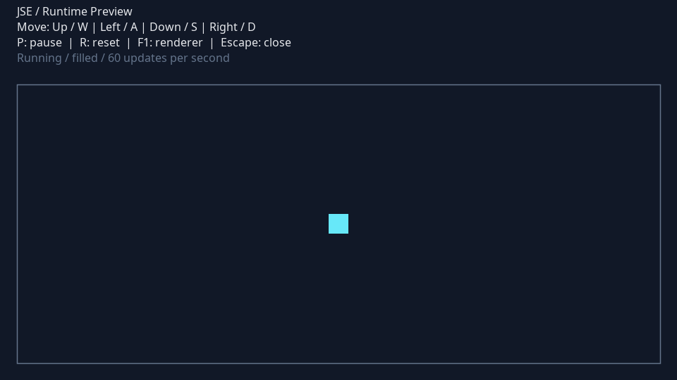
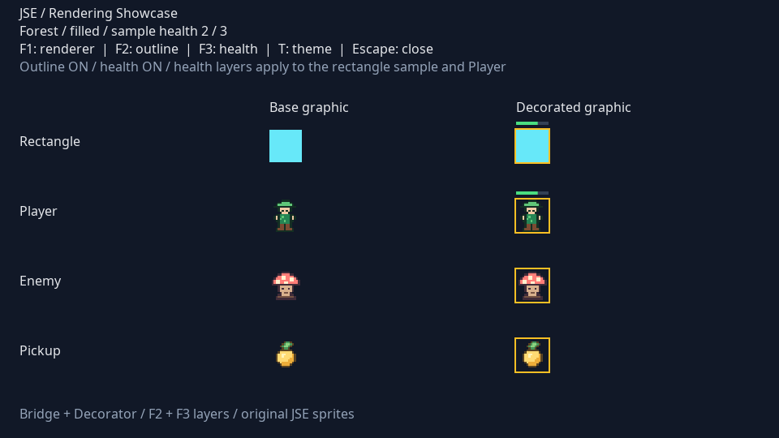

# Java Simple Engine

JSE is a compact Java 17 runtime for 2D desktop applications. It provides fixed updates, scene lifecycle, keyboard actions and interchangeable Java2D rendering. A configurable preview and rendering showcase run independently of the planned Arena game.



## Build and run

Install **JDK 17 or newer**. The Maven Wrapper selects Maven 3.9.9; the first build downloads build dependencies. Production code uses the JDK only.

```sh
./mvnw clean verify
java -jar target/jse-demo.jar
```

On Windows, replace `./mvnw` with `mvnw.cmd`. The packaged application runs without Maven, an IDE or a network connection. A desktop display is required for the window. Tests and help work without a display:

```sh
java -Djava.awt.headless=true -jar target/jse-demo.jar --help
```

The preview supports movement with WASD or arrows, **P** to pause/resume, **R** to reset, **F1** to switch Filled/Wireframe rendering and **Escape** to close. Losing window focus clears input and pauses movement; press P after returning. Reset centers the object and resumes movement.

Run the rendering showcase to compare plain and decorated graphics:

```sh
java -jar target/jse-demo.jar --example showcase
```

Use **F1** for Filled/Wireframe, **F2** for outline, **F3** for health bars, **T** for Forest/Space sprites and **Escape** to close. The sample health is 2/3; only Player and the rectangle health sample receive a health layer. Both examples support `--config FILE`; `--example preview` explicitly selects the default preview. Binding conflicts are checked only among the selected example's active actions, so existing Preview overrides can still use T/F2/F3.



## Configuration

Runtime defaults live in [jse.properties](src/main/resources/jse.properties); showcase visuals and sprite paths live in [showcase.properties](src/main/resources/showcase.properties). Supply a UTF-8 file containing only the values to override:

```properties
window.width=1024
window.height=640
preview.speed=300
render.mode=WIREFRAME
input.move_up=I,UP
```

```sh
java -jar target/jse-demo.jar --config preview.properties
```

Showcase overrides include `showcase.outline_width`, `showcase.bar_offset`, `showcase.bar_height`, `showcase.health_current`, `showcase.health_max` and each `showcase.forest_*` / `showcase.space_*` sprite path. Showcase layout is checked before its window opens, including the border, health bar and Wireframe resource labels. Larger samples or fonts may need a larger window.

Unknown keys, conflicting bindings, invalid colors and layouts that cannot fit the object are rejected before startup. Resource paths are relative to the classpath; configured sprites are preloaded before the update timer starts.

## Project status

The runtime foundation, Bridge and Decorator are implemented, with two working renderer styles and two independently runnable examples. Six original transparent sprites are packaged; their editable source and attribution are included.

The Arena game, themed factories, AI and events remain planned. The incoming basic `jse.factory.GameObject`, `Player` and `Enemy` classes are an early model sketch; they do not yet implement the shared game contracts. See [development status](docs/Development-Status.md) for completed work and the next handoff.

## Team

| Contributor | Responsibility | Design patterns |
| --- | --- | --- |
| Sabirzhanov Emil | Runtime, desktop host, input, rendering, assets, rendering showcase | Bridge; Decorator |
| Baktiyarova Aruzhan | Game object model, spawners, Forest/Space families, arena layout | Factory Method; Abstract Factory |
| Roziyeva Yasmina | World, AI, collisions, events, rules, game scenes and observers | Strategy; Observer |

Bridge and Decorator are implemented. Factory Method, Abstract Factory, Strategy and Observer remain planned; their intended structures and acceptance checks are documented individually.

## Documentation

- [Technical specification](docs/JSE-Technical-Specification.md): scope, contracts, game behavior and acceptance criteria.
- [Implementation plan](docs/Implementation-Plan.md): completed foundation steps and team milestones.
- [Integration guide](docs/Integration-Guide.md): concrete boundaries for parallel development.
- [Runtime design](docs/design/Runtime-Foundation.md): lifecycle and timing decisions.
- [Verification](docs/Verification.md): commands, results and practical limits.
- [Contributing](CONTRIBUTING.md) and [GitHub setup](docs/GitHub-Setup.md).

[Runtime architecture](docs/uml/rendered/runtime-architecture.svg), runtime lifecycle and [rendering patterns](docs/uml/rendered/rendering-patterns.svg) describe implemented code. The game diagrams are explicitly marked as planned integration.
