# Java Simple Engine

Technical report · Software Design Patterns

Sabirzhanov Emil
Baktiyarova Aruzhan
Roziyeva Yasmina

## Abstract

Java Simple Engine is a Java desktop application built around a small collection game. A player moves through an arena, collects pickups and loses health on enemy contact. The same objects can be drawn with two renderer styles, decorated with optional outlines and health bars, and recreated as a Forest or Space family. Enemy movement can change during a run. A separate event log can be disconnected while the score and health display continues to update.

The project uses these interactions to examine six design patterns in working code: Factory Method, Abstract Factory, Bridge, Decorator, Strategy and Observer. The report explains the boundaries between them, traces a pickup through the update cycle, and records the checks performed on the application. The final suite contains {TEST_COUNT} tests in {TEST_CLASSES} classes, with no failures, errors or skipped tests. Desktop checks cover {ROUTE_CYCLES} navigation cycles on {PLATFORM} with Java {DESKTOP_JAVA}. The runtime needs only the JDK; the source build uses Maven Wrapper and JUnit for tests.

<!-- contents -->

## 1. Introduction

A small game quickly acquires several independent reasons to change. Adding a Space theme affects which objects and sprites are created. Showing a health bar affects drawing. Giving an enemy a different movement rule affects simulation. Recording a collision affects the user interface, but it should not make the collision code responsible for drawing a log.

JSE keeps those changes separate and connects them in one arena. The course brief requires at least six distinct patterns, with two assigned to each contributor, and a report containing code, application screenshots and UML [1]. This project uses the pattern definitions from Design Patterns [2]. The patterns are assessed through the behavior of the application and tests rather than through the number of interfaces in the repository.

The scope is deliberately small: one bounded arena, keyboard input, a fixed update loop and Java2D graphics. There is no networking, saved game, sound system or 3D backend. Forest and Space differ in their concrete products and artwork; they share the same gameplay rules. The default runtime preview remains available as an isolated example, while the submission launchers open the game menu.

A successful run must preserve object identity and health when graphics change, use a consistent object family after a theme change, replace an enemy's strategy without replacing the enemy, and keep HUD subscriptions alive when the log is detached. Reset and menu transitions must close the outgoing run. These requirements determine the implementation choices discussed below.

## 2. Architecture and execution

### 2.1 Ownership and dependencies

The composition root, DemoApplication, reads typed settings, preloads sprites and creates the Swing host. JseEngine calls a Scene through its lifecycle interface. TitleScene, ArenaScene and ShowcaseScene implement that interface. The core package has no dependency on the world model, AI or event bus.

ArenaRun owns the state of one play session: World, the player, AI and motion systems, collision rules, an EventBus and its observers. GameScenes retains visual preferences and the log preference between sessions. A reset or theme change creates a new ArenaRun with a new run ID. This keeps score, health, pending mutations and subscriptions from leaking into the next game.

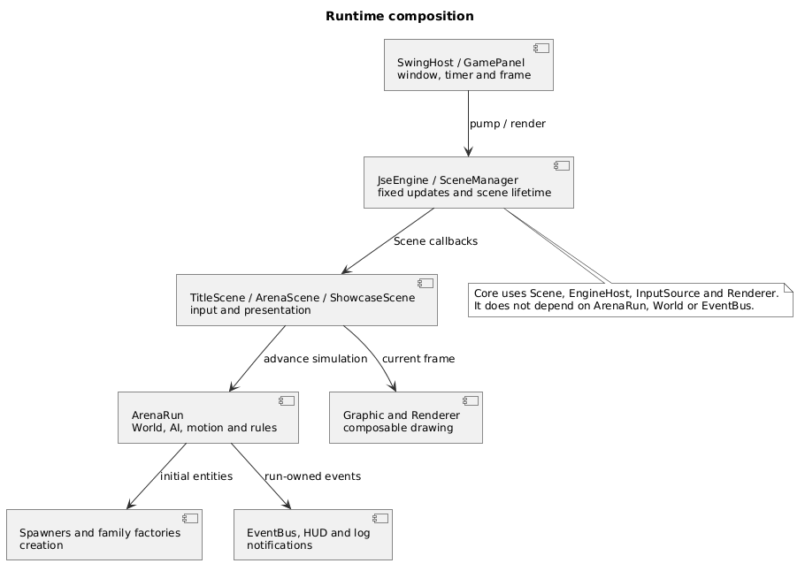

| Area | Main types | Responsibility |
| --- | --- | --- |
| Runtime | JseEngine, SceneManager, FixedStepClock | Time, scene transitions and shutdown |
| Desktop | SwingHost, GamePanel, SwingInputSource | Window, drawing frames and keyboard actions |
| Model | World, GameObject, WorldView | Identity, entity state and committed lifecycle changes |
| Creation | EntitySpawner, family factories | Category validation and themed products |
| Simulation | AiSystem, MotionSystem, CollisionSystem, ArenaRules | Velocity decisions, movement and collision consequences |
| Presentation | Graphic, decorators, ArenaScene, observers | Drawing, HUD values and bounded log history |

### 2.2 Fixed updates and frame lifetime

The bundled profile requests 60 updates per second. A Swing timer supplies pulses on the event dispatch thread [3]; FixedStepClock converts elapsed nanoseconds into fixed steps. It accepts at most 0.25 seconds from one pulse and executes at most five updates. Excess whole steps are dropped instead of extending a long catch-up loop. This is a responsiveness policy, not a claim that every desktop reaches a measured frame rate.

A scene transition ends the current catch-up batch, clears input and resets the accumulator. The outgoing scene receives onExit before its replacement enters. Engine failure also closes the active scene and clears input. Runtime tests use explicit timestamps to check these paths without sleeps.

A drawing frame has a shorter lifetime. GamePanel copies the supplied Graphics2D, begins a FrameRenderer frame, asks the engine to render, ends the frame and disposes the copy in finally blocks. Renderers retain no Graphics2D after endFrame. Sprites are loaded before the timer starts; frame rendering performs cache lookups.

### 2.3 Order inside one arena update

ArenaRun first checks whether the session is paused or finished. For an active update, it calculates player velocity, asks every enemy strategy for a velocity using one pre-motion WorldView, moves entities, finds overlaps, applies rules, commits queued additions and removals, and evaluates the outcome. The order matters: a collected pickup becomes unavailable immediately, while its removal event follows the collection event at commit time. Loss takes priority when health reaches zero on the same update that reaches the target score.

<!-- source: src/main/java/jse/demo/ArenaRun.java | public void advance( | The arena update order. -->

## 3. Rendering without entity subclasses

### 3.1 Bridge: separate the graphic from the renderer

A SpriteGraphic identifies an image; a RectangleGraphic describes a colored rectangle. Neither chooses the Java2D drawing style. Graphic holds a Renderer reference, and concrete renderers implement the drawing operations. FilledRenderer paints sprites and filled geometry. WireframeRenderer uses bounds and outlines to show the same scene in a different style.

This is the Bridge boundary: graphic types and renderer styles can vary independently. Changing F1 replaces the renderer used by existing graphics. It does not spawn new entities or change their positions, IDs, health or strategies. Both concrete implementations use Java2D. The project demonstrates two rendering styles, not two independent platform backends or a 2D/3D bridge.

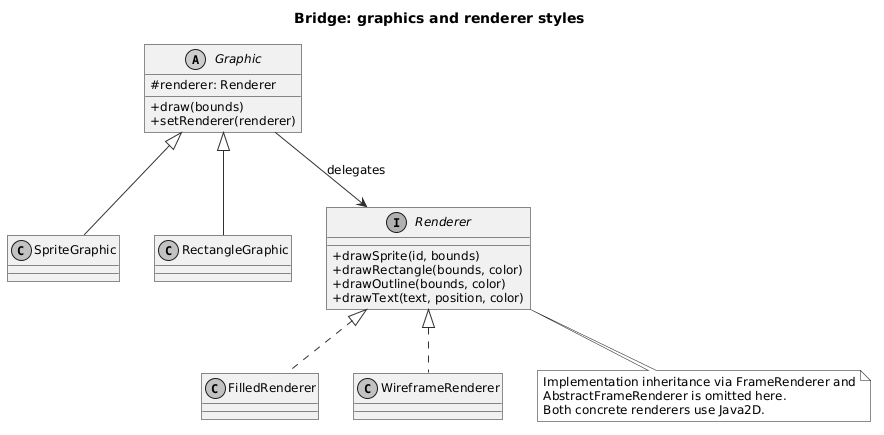

<!-- source: src/main/java/jse/render/SpriteGraphic.java | public void draw( | The sprite graphic delegates drawing through its renderer reference. -->

The benefit is visible even with this small set of types. Without the separation, each new graphic category would need to account for both styles. Here, a new graphic only needs to express its drawing operations through Renderer. A new renderer implements those operations and supplies its frame lifecycle through FrameRenderer.

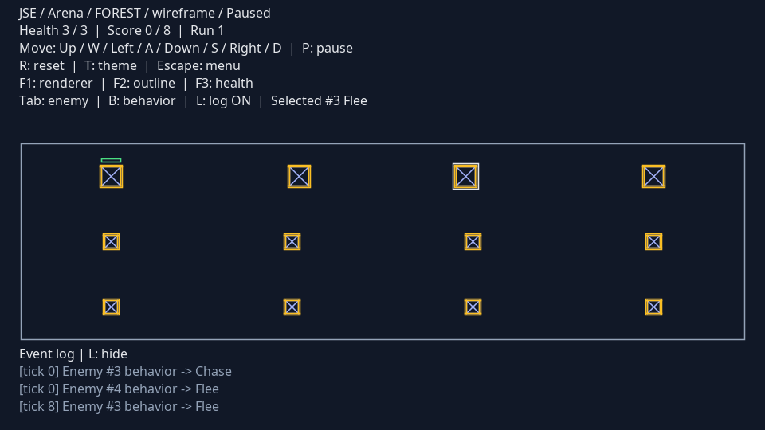

### 3.2 Decorator: compose optional visual layers

The outline and health bar are optional layers around a base Graphic. GraphicDecorator draws the wrapped component first and adds its own layer afterwards. It also propagates renderer replacement into the wrapped component. The order of composition is base, outline, then health bar.

<!-- source: src/main/java/jse/render/GraphicDecorator.java | public final void draw( | Drawing a wrapped component before the extra layer. -->

GraphicLayers always starts from the undecorated base. Repeated F2/F3 toggles therefore rebuild a short chain instead of nesting another copy of the same layer on every key press. EntityGraphics caches the applied choices per object and releases references when objects disappear or the scene exits.

<!-- source: src/main/java/jse/render/GraphicLayers.java | public static Graphic compose( | Building optional layers from a known base. -->

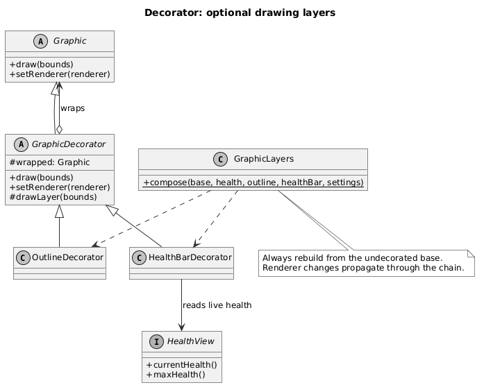

In the arena, Player implements HealthView, so the bar reads real health after contact damage. In Showcase, a fixed sample health value makes base and decorated graphics easy to compare. A health bar is not attached to enemies or pickups because they do not supply that view. This avoids introducing fake health into the model just to satisfy a visual option.

The rendering tests check drawing order, renderer propagation and bounded decorator depth. Image-based checks also cover frame cleanup. Arena tests pause simulation, toggle visual choices repeatedly, and verify that the model remains unchanged; separate AI tests cover movement.

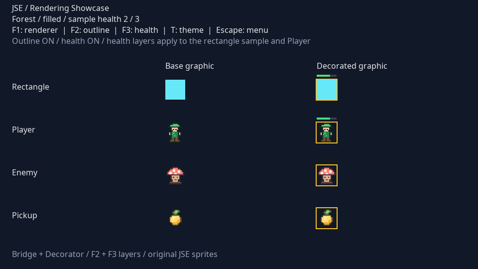

## 4. Creating a consistent world

### 4.1 Factory Method: one registration flow, three categories

EntitySpawner owns the common spawning algorithm. Its final spawn method asks a subclass to create a product, checks the result's category and family, and queues it in World. PlayerSpawner, EnemySpawner and PickupSpawner override createObject. This protected operation is the Factory Method; the public algorithm controls validation and registration.

<!-- source: src/main/java/jse/factory/EntitySpawner.java | public final T spawn( | Product validation stays in the common spawning algorithm. -->

World then validates identity, bounds and capacity, assigns a monotonically increasing ID, and holds the object pending until commitChanges. The complete bounds must fit the arena. A product from the wrong category or family never becomes active.

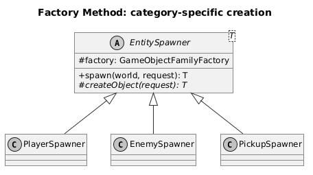

This design prevents the three spawners from acquiring slightly different registration rules. It also gives category-specific creation a visible extension point without putting a switch over every product type inside World.

### 4.2 Abstract Factory: choose the family once

GameObjectFamilyFactory defines createPlayer, createEnemy and createPickup. ForestFactory returns ForestPlayer, ForestEnemy and ForestPickup. SpaceFactory returns the corresponding Space products. Each concrete product retains a ThemeId, and each factory checks the requested size against that category's settings before construction.

<!-- source: src/main/java/jse/factory/ForestFactory.java | public Enemy createEnemy( | A concrete factory chooses the product and sprite while retaining category validation. -->

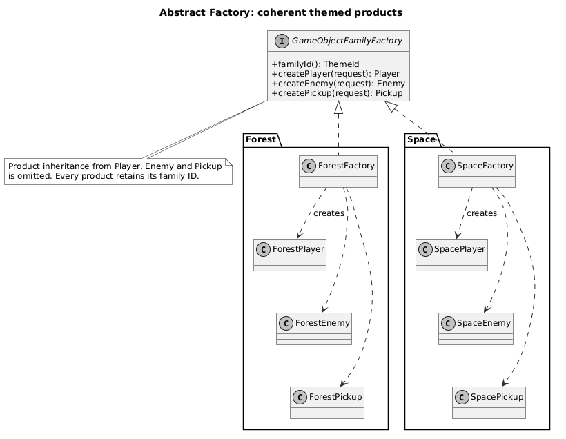

ArenaRun selects one factory for a run and passes it to all spawners. Theme selection is therefore a composition decision. Pressing T starts a fresh run using the other family; it does not retheme existing objects in place. Score and health reset, while visual preferences survive. Factory Method answers which category is created; Abstract Factory answers which related family supplies that category.

There is intentional repetition in the two concrete factories. Their short creation methods make the product families explicit. A shared factory superclass would remove a few lines while making the pattern roles harder to inspect in this project.

## 5. Enemy decisions and event consumers

### 5.1 Strategy: change an enemy's decision rule

BehaviorStrategy returns a velocity in world units per second. It receives the enemy as context and an immutable WorldView containing positions from before motion. AiSystem applies the returned vector to the enemy; MotionSystem updates position later. Strategies in this implementation do not move the entity themselves.

The three demonstrated strategies have different rules. Chase moves toward the player. Flee moves away while the player is within a configured radius and returns zero outside it; exact overlap uses a stable rightward escape. Patrol alternates between two waypoints. It limits the final step to reach a waypoint without overshooting and changes its target for the next update. Idle is the safe default for newly created enemies.

<!-- source: src/main/java/jse/ai/PatrolBehavior.java | public Vec2 desiredVelocity( | A stateful patrol limits its final step and retains its next target. -->

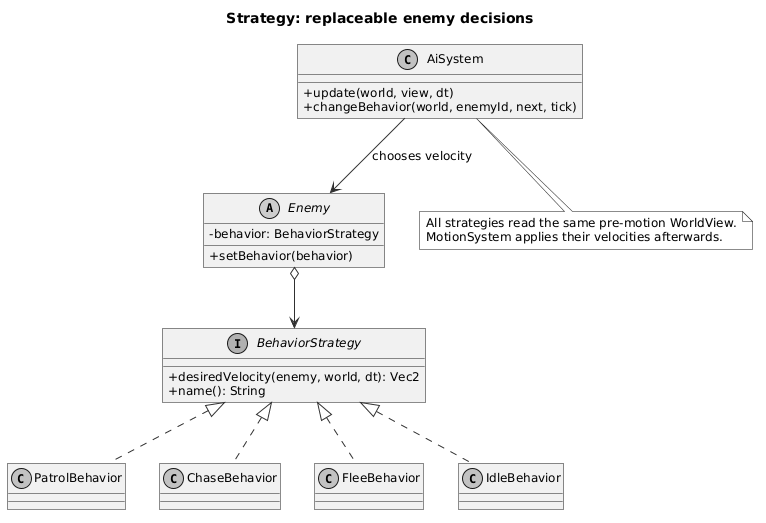

A PatrolBehavior instance belongs to one enemy because its target direction is mutable state. Sharing one instance would couple the enemies' routes. The tests check that two patrol instances change targets independently.

Tab selects an enemy and B cycles Patrol, Chase and Flee on that same object. AiSystem publishes BehaviorChanged only after replacement. The object's ID, family and position are retained. Selection and replacement are allowed during pause and after an outcome; movement remains frozen until a running session advances.

### 5.2 Observer: keep display consumers independent

ArenaRules publishes collection, health and terminal outcome events. World publishes committed entity lifecycle changes. AiSystem publishes behavior changes. These publishers know EventBus and event records, not a concrete HUD or a text log.

HudObserver starts from the player's initial health and subscribes to ItemCollected, HealthChanged and GameFinished. It holds the displayed score, health and notified result. ArenaScene reads score and health from it; the running/paused/outcome heading reads the authoritative ArenaRules status. EventLogObserver maintains the latest 50 lines by default, of which the arena displays three.

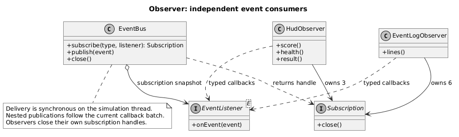

EventBus delivers an event synchronously to listeners registered for that exact class. It snapshots listeners before invoking them. Subscription changes apply to the next event. A publication made from inside a listener enters a queue and is delivered after the current callback batch, so nested callbacks do not interrupt that batch.

<!-- source: src/main/java/jse/event/EventBus.java | public void publish( | Synchronous publication with deferred nested events. -->

Pressing L closes the log's six subscription handles. HUD subscriptions remain active, so collecting an item or taking damage still updates the display. Re-enabling the log creates an empty observer; it does not replay events from the detached interval. Reset, theme change and menu exit close both observers and the old event bus.

This implementation has deliberate limits. EventBus runs on the simulation thread and is not thread-safe. The nested publication queue has no capacity or delivery budget. Listener exceptions are reported to standard error and do not stop the remaining listeners. A chain of listeners that publishes indefinitely could block an update. No asynchronous delivery guarantee or next-tick event protocol is claimed.

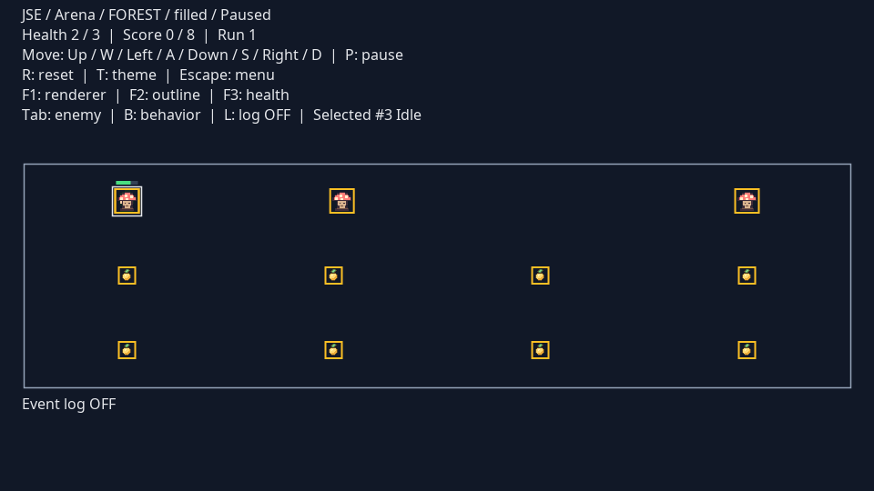

## 6. One pickup through the system

The interaction between patterns is easiest to inspect during collection. Both the player and pickup have already passed through their category spawners and the selected family factory. CollisionSystem returns an ordered pair of overlapping IDs. ArenaRules resolves the pair against active entities, marks the pickup for removal, increments score and publishes ItemCollected.

Marking removal makes the pickup unavailable immediately, so a duplicate collision pair cannot score it twice. The HUD callback updates the score and the log callback appends a line. World then commits the removal and publishes EntityRemoved. Finally, ArenaRules checks health and target score and publishes GameFinished on the first terminal transition. Rendering uses the remaining objects through the same graphics and optional layers.

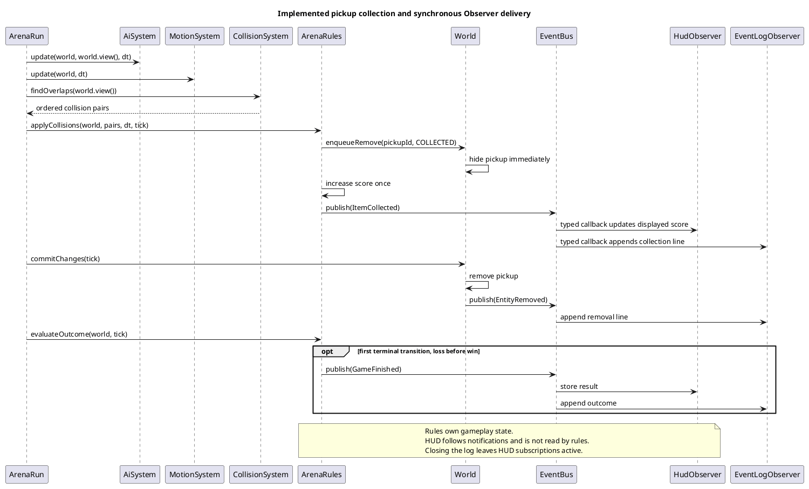

The sequence shows why the event and world mutation contracts must be distinguished. World defers collection changes to a commit boundary. EventBus normally delivers notifications immediately. Deferring nested publications does not turn all events into a next-tick queue.

## 7. Verification and results

### 7.1 Build and test evidence

The application was built and tested on Linux using OpenJDK {TEST_JAVA}. Compilation targets Java 17. The command was ./mvnw --batch-mode --no-transfer-progress clean verify. It compiled the application, ran the suite, packaged the executable JAR and checked the Java formatting rules. The result was {TEST_COUNT} tests across {TEST_CLASSES} test classes, with zero failures, errors or skips. The recorded application source digest is stored in docs/verification.json.

| Boundary | Representative tests | Behavior checked |
| --- | --- | --- |
| Time and lifecycle | RuntimeTest | Fixed steps, catch-up bounds, transition ordering, failure cleanup and owner thread |
| Creation and world | FamilyFactoryTest, WorldTest | Category/family checks, pending changes, bounds, capacity and stable IDs |
| Rendering | GraphicDecoratorTest, RendererImageTest, EntityGraphicsTest | Layer order and depth, live health, frame cleanup and visual isolation |
| Behavior | BehaviorTest, ArenaBehaviorsTest | Velocity decisions, patrol state, runtime swaps and paused controls |
| Events and rules | EventBusTest, ObserverTest, ArenaIntegrationTest | Nested order, subscription snapshots, log independence, collection, cooldown and outcome priority |
| Input and configuration | SwingInputSourceTest, GameSettingsTest, LaunchSettingsTest | Aliases, focus handling, invalid settings, key conflicts and layout bounds |

The tests do not replace desktop checks. Headless rendering can inspect pixels and draw calls, but it cannot establish that a real window opens, receives a native key or closes after a navigation sequence.

### 7.2 Desktop checks and captured figures

DesktopVerification runs against the packaged JAR and opens the real SwingHost. On {PLATFORM} with Java {DESKTOP_JAVA}, it completed {ROUTE_CYCLES} cycles through arena entry, reset, theme change, menu and showcase, checking closure of the replaced event buses. It also exercised renderer changes, enemy selection, strategy replacement and log detach/re-attach. The controlled contact fixture verified a real health event while the log was absent. Figures in this report were captured from that run.

{NATIVE_ENTRY_NOTE} The remaining controls used the installed Swing action bindings. This establishes the Swing-to-engine command path and window lifecycle; it does not establish complete physical-keyboard coverage. Windows and macOS desktop checks were not performed. No frame-rate, memory or latency benchmark was conducted.

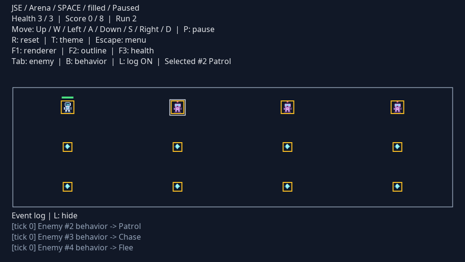

### 7.3 A boundary case found during review

Layout validation originally used the largest entity width for both grid axes. Because the bundled profiles construct square entities, ordinary launches did not expose the error. A regression test supplied a tall, narrow player through the typed settings API. The old implementation accepted a layout that could not fit vertically. Validation now measures width and height independently; the test checks rejection of a tall object and acceptance of a wide, shallow object.

The event tests also cover a listener removing another listener and adding a replacement during dispatch. The current event still reaches its original snapshot; the next event reaches the replacement. This behavior is important when an observer's lifetime ends during a callback.

### 7.4 Source and delivery quality

Java sources, tests and the desktop verifier use four-space indentation, explicit imports, braces around control-flow bodies and one declaration per line. Spotless runs the pinned Eclipse formatter as part of verify. The formatting profile is committed, so another contributor can reproduce the style rather than infer it from examples. The choices follow ordinary Java conventions and were cross-checked against Google Java Style and JUnit's contributor guidance [5,6]; four-space indentation is a project choice.

The application has no third-party production dependency. Maven's JAR plugin writes the main-class manifest; a shading stage is unnecessary. Maven Wrapper selects version 3.9.9 [4]. JUnit and formatting tools are build-time dependencies. Python and LibreOffice are used to publish the report, not to build or run the application.

## 8. Conclusion and further work

The arena demonstrates all six assigned patterns in the same application. Creation produces validated themed entities; strategies choose enemy velocity; rule and lifecycle events update independent observers; graphics delegate to interchangeable renderers and compose optional layers. The important boundaries survive reset and navigation, and visual changes leave simulation state intact. The {TEST_COUNT}-test suite and recorded desktop run provide evidence for these behaviors within the stated platform and input limits.

The design has costs. Entities reference Graphic, so this is not a renderer-free domain model. Swing keeps the program small but ties the desktop host to its event thread. Pairwise collision detection is suitable for the configured small arena; larger worlds would need a different broad phase. Synchronous event callbacks are easy to follow but share the update's execution budget.

Further work should start with those constraints. A bounded event queue would need an explicit overflow policy, a delivery budget and tests for observer failures and recursive publishers. A second desktop verification run on Windows and macOS should cover real key input, focus changes and packaged launchers. If entity counts grow, collision detection should first be measured and then replaced with a spatial partition while retaining deterministic pair order. Audio, persistence and additional levels are separate features rather than prerequisites for the six current pattern demonstrations.

## Appendix A. Team responsibilities and reproduction

| Contributor | Assigned patterns | Main implementation areas |
| --- | --- | --- |
| Sabirzhanov Emil | Bridge; Decorator | Runtime, desktop host, input, graphics, renderers and visual layers |
| Baktiyarova Aruzhan | Factory Method; Abstract Factory | Object categories, spawners, Forest and Space products |
| Roziyeva Yasmina | Strategy; Observer | World and events, AI, collisions, game rules and observers |

The table records the agreed pattern responsibilities. Integration changes connect these areas; Git history records the actual commits. It does not imply exclusive authorship of every file in an area.

Build the extracted source using a JDK 17 or newer. The first Wrapper build needs network access for Maven and build dependencies. The packaged JAR then runs offline with its bundled sprites. A graphical desktop is required for the application; tests and --help also work in headless mode.

```sh
./mvnw clean verify
java -jar target/jse-demo.jar --example game
```

On Windows, use mvnw.cmd clean verify. The submission folder also contains Run-JSE.sh and Run-JSE.bat, which open the game menu directly.

| Context | Controls |
| --- | --- |
| Menu | Enter opens Arena; H opens Showcase; Escape closes |
| Arena movement | WASD or arrows; P pauses; R starts a fresh run |
| Arena graphics | F1 switches renderer; F2 toggles outline; F3 toggles health bar |
| Arena AI and log | Tab selects an enemy; B replaces its behavior; L toggles the log |
| Theme and navigation | T starts the other theme; Escape returns to the menu |
| Showcase | F1/F2/F3 compare layers and styles; T changes sample sprites; Escape returns |

For a short demonstration, enter the arena, pause, switch F1/F2/F3 and show that entity state is retained. Change the selected enemy's behavior with Tab and B, then resume to observe movement. Detach the log with L and collect a pickup or take damage to show that the HUD continues to follow events. Reset, switch theme and return through Showcase to show the separate creation and scene lifetimes.

## References

[1] Software Design Patterns. Final Project Defense Requirements. Course handout supplied to the team.

[2] Gamma, E., Helm, R., Johnson, R. and Vlissides, J. Design Patterns: Elements of Reusable Object-Oriented Software. Addison-Wesley. ISBN 9780201633610. [Publisher record](https://www.informit.com/store/design-patterns-elements-of-reusable-object-oriented-9780201633610).

[3] Oracle. Java Platform, Standard Edition 17: javax.swing.Timer. [API reference](https://docs.oracle.com/en/java/javase/17/docs/api/java.desktop/javax/swing/Timer.html).

[4] Apache Maven. Maven Wrapper. [Build-tool documentation](https://maven.apache.org/wrapper/).

[5] Google. Google Java Style Guide. [Coding conventions](https://google.github.io/styleguide/javaguide.html).

[6] JUnit Team. Contributing: coding conventions and formatting. [Maintainer guidance](https://github.com/junit-team/junit-framework/blob/main/CONTRIBUTING.md).

Source listings are extracted from the repository when the report is generated. UML files and original screenshot captures are included with the source.
